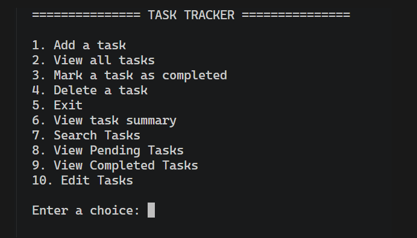
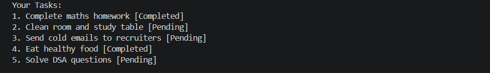
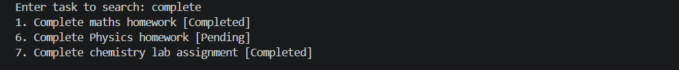

# 📝 CLI Task Tracker

<p align="center">

**A simple yet powerful command-line task management application built with Python.**

Organise your daily tasks, track your progress, and keep your productivity on track!

</p>

---

## 📌 About the Project

CLI Task Tracker is a beginner-friendly Python project designed to make everyday task management simple and organised.

Built using Python, this application allows users to create, view, edit, delete, search, and manage tasks directly through a command-line interface.

It also uses **JSON file handling** to store task information permanently, so your tasks remain available even after closing and reopening the application.

## ✨ Features

| Feature | Description |
|---|---|
| ➕ Add Tasks | Create new tasks with duplicate and empty-input validation. |
| 📋 View Tasks | Display all tasks with their completion status. |
| ✅ Mark Completed | Mark pending tasks as completed. |
| ✏️ Edit Tasks | Modify existing task titles. |
| 🗑️ Delete Tasks | Delete tasks with confirmation. |
| 🔍 Search Tasks | Find tasks using case-insensitive keyword searches. |
| ⏳ Pending Tasks | View only tasks that are not yet completed. |
| 🎯 Completed Tasks | View all completed tasks separately. |
| 📊 Task Summary | Get an overview of total, completed, and pending tasks. |
| 💾 Data Persistence | Automatically save and load tasks using JSON. |
| 🛡️ Backup Protection | Preserve corrupted JSON files through backup handling. |

## 🖥️ Screenshots

Here is a glimpse of CLI Task Tracker in action.

| 🏠 Main Menu | 📋 Task List |
|:---:|:---:|
|  |  |

| 📊 Task Summary | 🔍 Search Results |
|:---:|:---:|
|  |  |

## ⚙️ Technologies Used

- **Python 3** – Core programming language.
- **JSON** – Storing and retrieving task data.
- **os module** – File management and backup handling.
- **VS Code** – Development environment.

## 🚀 Getting Started

Follow these steps to run the project on your local machine.

### Prerequisites

- Python 3 installed on your system.
- Git installed (optional, for cloning the repository).

### Installation

**1. Clone the repository**

```bash
git clone https://github.com/dhruvbansal-532/CLI-Task-Tracker.git
```

**2. Navigate to the project directory**

```bash
cd Task-Tracker
```

**3. Run the application**

```bash
python task_tracker.py
```

If your system uses the Python launcher, you can also run:

```bash
py task_tracker.py
```

No external Python libraries are required.

## 📖 How to Use

After running the program, an interactive menu will appear:

```text
========== TASK TRACKER ==========

1. Add a task
2. View all tasks
3. Mark a task as completed
4. Delete a task
5. Exit
6. View task summary
7. Search Tasks
8. View Pending Tasks
9. View Completed Tasks
10. Edit Tasks
```

Enter the corresponding option number to perform an operation.

Your task data is automatically saved whenever changes are made.

## 💾 Data Storage

The application uses Python's built-in `json` module to store tasks in a file named `tasks.json`.

Each task is stored as a dictionary containing:

- `title` – The task description.
- `completed` – A Boolean value representing its completion status.

Example:

```json
[
    {
        "title": "Learn Python",
        "completed": false
    },
    {
        "title": "Practice DSA",
        "completed": true
    }
]
```

The application also handles missing and corrupted JSON files. When corrupted data is detected, it attempts to preserve the original file as `tasks_backup.json` before starting with an empty task list.

## 📂 Project Structure

```text
Task-Tracker/
│
├── task_tracker.py
├── README.md
├── tasks.json
│
└── screenshots/
    ├── menu.png
    ├── tasks-list.png
    ├── tasks-summary.png
    └── search-results.png
```

*Note: `tasks.json` is generated automatically when task data is first saved.*

## 🧠 Concepts Learned

This project helped me practise and strengthen several Python programming concepts:

- Variables and data types
- Lists and dictionaries
- Conditional statements and loops
- Functions and modular programming
- List indexing and iteration
- String manipulation
- Exception handling
- File handling
- JSON serialization and deserialization
- Working with Python's built-in modules

## 🔮 Future Improvements

Some ideas for future versions:

- Add task priorities (High, Medium, Low).
- Introduce task deadlines and due dates.
- Add sorting and advanced filtering.
- Develop a graphical user interface using Tkinter.

## 👨‍💻 Author

**Dhruv Bansal**

Built as part of my journey of learning Python through practical projects.

---

⭐ If you find this project useful, feel free to explore the code and try it out!

**Thanks for visiting!**
